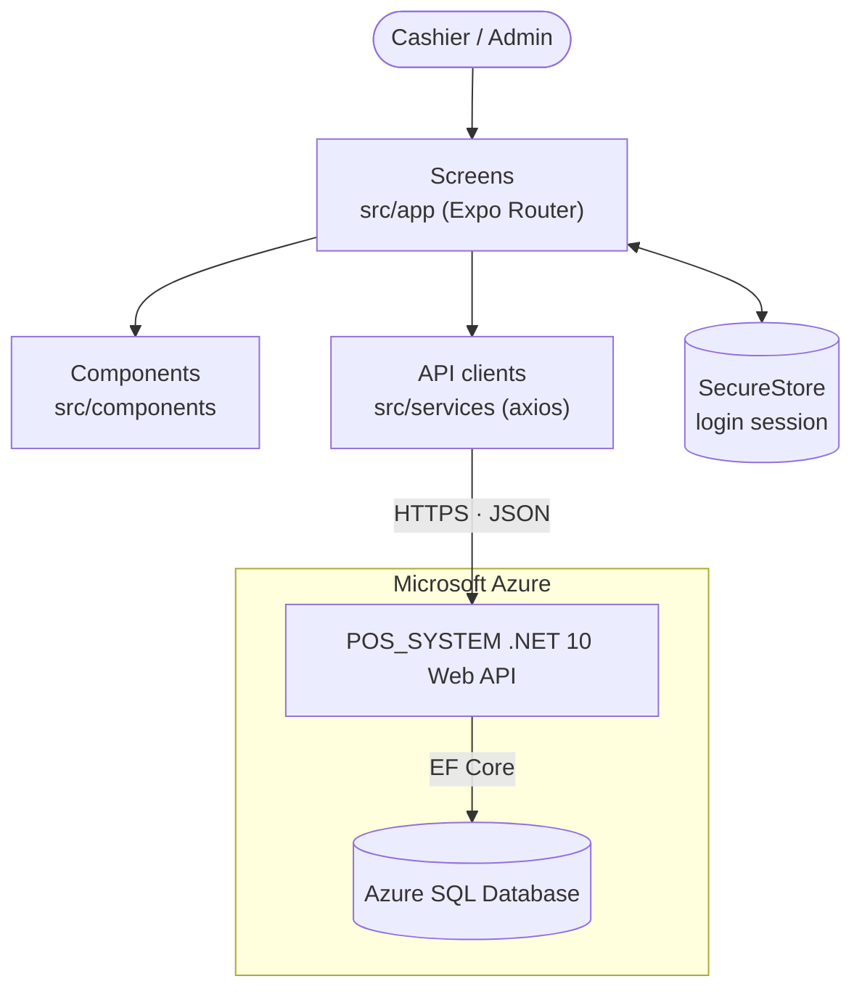

# POS System — Mobile App (Frontend)

A **React Native + Expo** point-of-sale application for retail businesses. It is the mobile client for the **POS_SYSTEM .NET 10 Web API**, which is deployed on **Microsoft Azure** with its data stored in **Azure SQL Database**.


---

## Table of Contents

1. [Project Overview](#1-project-overview)
2. [Application Features](#2-application-features)
3. [Technology Stack](#3-technology-stack)
4. [Project Folder Structure](#4-project-folder-structure)
5. [Application Architecture](#5-application-architecture)
6. [Navigation and Screens](#6-navigation-and-screens)
7. [API Integration with the .NET 10 Backend](#7-api-integration-with-the-net-10-backend)
8. [UI Components and Styling](#8-ui-components-and-styling)
9. [Installation and Running](#9-installation-and-running)
10. [Android Development and Release Builds](#10-android-development-and-release-builds)
11. [Environment Variables and API Configuration](#11-environment-variables-and-api-configuration)
12. [Known Limitations](#12-known-limitations)
13. [License](#13-license)

---

## 1. Project Overview

Store staff use this app on a phone or tablet to ring up sales, process returns, manage products, customers, suppliers, purchases, stock and expenses, administer users and permissions, and close cashier shifts. It is a thin client: all business rules and data live in the **.NET 10 Web API** on Azure.

> **Current backend:** .NET 10 only (the earlier FastAPI backend has been replaced).

---

## 2. Application Features

| Area | What you can do |
|------|-----------------|
| **Authentication** | Sign in with username/email + password; company is detected from the credentials; session saved in secure device storage; log out from the side menu. |
| **POS / New Sale** | Cart, barcode lookup, retail/wholesale price, discounts, loyalty-point redemption, cash / card / split payment, **hold** or **draft** a sale. |
| **Receipts** | Print a receipt or send it through **WhatsApp**. |
| **Sales** | Sales history and detail, held sales, drafts, returns & refunds, cashier shift summary and close. |
| **Products** | Add/edit/delete, image upload, camera **barcode scanner**, **barcode labels**, price update and bulk price update; categories, brands, units. |
| **Inventory & purchasing** | Current stock (with PDF export), purchases, suppliers. |
| **Customers** | List, add, edit, view, loyalty points and history. |
| **Expenses** | Expense list with a donut chart by category, add expense. |
| **Users, roles & permissions** | Manage users and roles; assign permissions with a permission tree. |
| **Settings** | Company info (with logo upload) and branches. |
| **Permission-based menu** | The side menu only shows entries allowed by the user's permission keys. |

---

## 3. Technology Stack

| Category | Technology (versions from `package.json`) |
|----------|-------------------------------------------|
| Framework | **Expo** `~57.0.25` (SDK 57), **React Native** `0.86.3`, **React** `19.2.3` |
| Language | **TypeScript** `~6.0.3` (strict mode) |
| Navigation | **Expo Router** `~57.0.23` (file-based, `typedRoutes` on) |
| Styling | **NativeWind** `^4.2.6` + **Tailwind CSS** `^3.4.19` |
| HTTP client | **axios** `^1.19.0` |
| Device features | `expo-secure-store`, `expo-camera`, `expo-image-picker`, `expo-print`, `expo-sharing` |
| Barcodes & charts | `react-native-barcode-svg`, `react-native-svg` |
| Builds | **EAS Build**, `expo-dev-client` |
| Backend (external) | **.NET 10 Web API** on **Microsoft Azure**, **Azure SQL Database** |

---

## 4. Project Folder Structure

`node_modules/`, `.expo/`, `dist/` and generated native/build output are omitted.
 
```text
Frontend/
├── src/
│   ├── app/                          # Expo Router routes (file-based)
│   │   ├── _layout.tsx               # Root Stack + auth-token check
│   │   ├── index.tsx                 # Redirects "/" to "/pos"
│   │   ├── login.tsx                 # Login screen
│   │   └── (tabs)/                   # Route group for all signed-in screens
│   │       ├── pos/                  # New sale, sales-history, held-sales, drafts, returns, cashier-shift
│   │       ├── products/             # list, add, [id], scan, barcode-labels, price-update,
│   │       │                         #   bulk-price-update, categories, brands, units
│   │       ├── inventory/current-stock/
│   │       ├── purchases/            # list, add
│   │       ├── suppliers/            # list, add, [id], view/[id]
│   │       ├── customers/            # list, add, [id], view/[id], loyalty/ , loyalty/[id]
│   │       ├── expenses/             # list, add
│   │       ├── users/                # list, add, [id], view/[id], roles/, permissions/
│   │       └── settings/             # company-info/, branches/
│   ├── components/                   # Reusable UI (SideMenu, Dropdown, PaginationBar, PermissionTree,
│   │                                 #   ExpenseDonutChart, and *Card / *Row list items)
│   ├── services/                     # One axios-based API client per backend resource (19 files)
│   ├── hooks/
│   │   └── usePagination.ts          # Client-side pagination hook
│   ├── utils/                        # barcode.ts, printReceipt.ts, saleReceipt.ts, whatsapp.ts
│   └── config/
│       └── api.ts                    # API base URL (API_URL)
├── app.json                          # Expo app config (name, Android package, plugins)
├── eas.json                          # EAS Build profiles
├── package.json                      # Dependencies and scripts
├── tsconfig.json                     # TypeScript config (strict, "@/*" alias → ./src/*)
├── babel.config.js                   # babel-preset-expo + NativeWind
├── metro.config.js                   # Metro + NativeWind (global.css)
├── tailwind.config.js                # Tailwind content paths + NativeWind preset
├── global.css                        # Tailwind directives
├── expo-env.d.ts · nativewind-env.d.ts
└── LICENSE
```
 
> `app.json` references image files under `./assets/` (icon, splash, adaptive icon). That folder is not part of this source snapshot; make sure it exists in your repository.
 
---

## 5. Application Architecture



Screens use components and services; services call the .NET API. There is no global store or Context — each screen keeps its own state, and the login session is read from SecureStore.

---

## 6. Navigation and Screens

The root layout (`src/app/_layout.tsx`) shows a header-less `Stack`. `(tabs)/` is only a route group (no tab bar); screens are reached through the slide-in **side menu** (`SideMenu.tsx`).

**Start-up flow:** no stored token → `/login`; after login → `/products`; `/` redirects to `/pos`; logout clears SecureStore.

| Section | Routes |
|---------|--------|
| Login | `/login` |
| POS | `/pos`, `/pos/sales-history`, `/pos/sales-history/[id]`, `/pos/held-sales`, `/pos/drafts`, `/pos/returns`, `/pos/cashier-shift` |
| Products | `/products`, `/products/add`, `/products/[id]`, `/products/scan`, `/products/barcode-labels`, `/products/price-update`, `/products/bulk-price-update`, `/products/categories`, `/products/brands`, `/products/units` |
| Inventory | `/inventory/current-stock`, `/inventory/current-stock/[id]` |
| Purchases | `/purchases`, `/purchases/add` |
| Suppliers | `/suppliers`, `/suppliers/add`, `/suppliers/[id]`, `/suppliers/view/[id]` |
| Customers | `/customers`, `/customers/add`, `/customers/[id]`, `/customers/view/[id]`, `/customers/loyalty`, `/customers/loyalty/[id]` |
| Expenses | `/expenses`, `/expenses/add` |
| Users | `/users`, `/users/add`, `/users/[id]`, `/users/view/[id]`, `/users/roles`, `/users/roles/add`, `/users/roles/[id]`, `/users/permissions`, `/users/permissions/add` |
| Settings | `/settings/company-info`, `/settings/company-info/add`, `/settings/branches`, `/settings/branches/add`, `/settings/branches/[id]` |

> Some side-menu entries have no screen yet (Stock In/Out/Adjustment, Low Stock, Stock Count, Purchase Returns, Supplier Dues, Ledgers, Expense Categories, Activity Log, Tax & VAT, Invoice Template, Backup & Restore, Dashboard). They are placeholders, not implemented features.

---

## 7. API Integration with the .NET 10 Backend

```text
Mobile app ──HTTPS──▶ POS_SYSTEM .NET 10 Web API (Azure) ──TLS──▶ Azure SQL Database
```

- The app **never connects to the database**; it only calls the API, and the API connects to Azure SQL.
- Every file in `src/services/` creates an axios instance with `baseURL: API_URL` from `src/config/api.ts`.
- Responses use PascalCase names with `ID` (e.g. `ProductID`, `CategoryID`); errors are `{ "detail": "..." }` and are shown in alerts.
- **Login:** `POST /auth/verify-credentials` detects the company while typing, then `POST /auth/login` returns a JWT and `PermissionKeys`. `saveSession()` stores `auth_token` and `auth_user` in `expo-secure-store`.

| Service file | Backend routes |
|--------------|----------------|
| `authApi.ts` | `/auth/login`, `/auth/verify-credentials` |
| `companyApi.ts` · `branchApi.ts` | `/companies`, `/branches` |
| `productApi.ts` | `/products` (CRUD, categories, brands, units, next-code, by-barcode, bulk-price-update, price, upload-image) |
| `categoryApi.ts` · `brandApi.ts` · `unitApi.ts` | `/categories`, `/brands`, `/units` |
| `customerApi.ts` · `supplierApi.ts` | `/customers`, `/suppliers` |
| `saleApi.ts` | `/sales` (list, create, detail, delete, held, drafts, cashiers, next-invoice-no) |
| `saleReturnApi.ts` | `/sale-returns` |
| `purchaseApi.ts` | `/purchases` (+ branches, sizes, next-number) |
| `stockApi.ts` | `/stock` |
| `loyaltyApi.ts` | `/loyalty` (summary, history, adjust) |
| `expenseApi.ts` | `/expenses` (+ categories, summary, by-category) |
| `cashierShiftApi.ts` | `/cashier-shifts` |
| `userApi.ts` · `roleApi.ts` · `permissionApi.ts` | `/users`, `/roles`, `/permissions` |

---

## 8. UI Components and Styling

**NativeWind v4** brings Tailwind classes to React Native — components use `className` (for example `className="flex-1 items-center justify-center bg-gray-50"`). Setup: `tailwind.config.js`, `global.css` (imported in `_layout.tsx`), `babel.config.js` and `metro.config.js`. The UI uses default Tailwind colours and Ionicons icons.

| Component | Purpose |
|-----------|---------|
| `SideMenu` | Animated drawer, filtered by permission keys, with logout |
| `Dropdown` | Generic `{ id, name }` select |
| `PaginationBar` + `usePagination` | Client-side pagination |
| `PermissionTree` / `PermissionRow` | Permission selection |
| `ExpenseDonutChart` | SVG donut chart of expenses by category |
| `*Card`, `*Row` | List items for products, customers, suppliers, stock, sales, users, roles, etc. |

Utilities in `src/utils/`: `generateEAN13()` (barcode), `printReceipt` / `saleReceipt` (receipts via `expo-print`), `whatsapp` (phone formatting and WhatsApp share).

---

## 9. Installation and Running

**You need:** Node.js (LTS), Git, Android Studio (SDK + emulator) and a running POS API.

```bash
git clone <your-repository-url>
cd <repository>/Frontend
npm install
```

Set your API address in `src/config/api.ts` (see [§11](#11-environment-variables-and-api-configuration)), then run. The app uses native modules, so use a **development build**, not Expo Go:

```bash
npm run android     # build and run on an emulator / connected phone
npm start           # start the dev server afterwards
```

Other scripts: `npm run ios`, `npm run web`, `npm run lint`.

**Local backend:** run the .NET API with `--urls "http://0.0.0.0:5000"` and set `API_URL` to `http://<your-computer-IP>:5000` (Android emulator: `http://10.0.2.2:5000`). Plain HTTP is allowed on Android by `app.json` (`usesCleartextTraffic: true`) — use HTTPS in production.

---

## 10. Android Development and Release Builds

App package: **`com.faysaal70.frontend`**. Build profiles in `eas.json`:

| Profile | Purpose |
|---------|---------|
| `development` | Development client (internal) |
| `preview` | Installable **APK** for testing |
| `production` | Store release, build number auto-incremented |

```bash
npm install -g eas-cli
eas login

eas build --platform android --profile preview       # APK for testing
eas build --platform android --profile production    # bundle for Google Play
eas submit --platform android --profile production   # upload to Google Play
```

EAS manages the signing keystore for you — keep your credentials private. There is no `android/` folder in the repo; Expo generates it when you run `npm run android` or `npx expo prebuild`.

**Before a release:** set `API_URL` to the production HTTPS address, update `version` in `app.json`, consider disabling `usesCleartextTraffic`, and test the APK on a real device.

---

## 11. Environment Variables and API Configuration

The API address is a constant in **`src/config/api.ts`**:

```ts
export const API_URL = "https://<your-api-host>";   // your Azure-hosted .NET 10 API
```

`eas.json` sets `EXPO_PUBLIC_API_URL` for the `preview` profile, but **no code reads it yet**. To use it, change `api.ts` to:

```ts
export const API_URL = process.env.EXPO_PUBLIC_API_URL ?? "https://<your-api-host>";
```

| Item | Where it lives |
|------|----------------|
| API base URL | `src/config/api.ts` / `EXPO_PUBLIC_API_URL` |
| Azure SQL connection string, JWT secret | **Backend only** (Azure app settings) — never in this app |
| Login token | Device SecureStore (`auth_token`) |

`EXPO_PUBLIC_*` values are embedded in the app and visible to anyone — **never put passwords, API keys, tokens or connection strings in them.** The API must be reachable over HTTPS with a certificate chain Android trusts (include the intermediate certificate on the server).

---

## 12. Known Limitations

- **Token not sent:** the JWT is stored but no request carries it. Add an `Authorization: Bearer` header (axios interceptor) before the backend enforces `[Authorize]`.
- **Query names differ from the .NET API:** the app sends snake_case (`date_from`, `customer_id`, `category_id`, `purchase_date`, `expense_date`) while the API expects camelCase (`dateFrom`, `customerId`, `categoryId`, `purchaseDate`, `expenseDate`), so filters on Sales, Purchases and Stock and the next-number previews are ignored.
- **Extra sale fields:** `POST /sales` also sends `Payments`, `DiscountType` and `DiscountValue`, which the .NET API ignores.
- **Hard-coded API URL** (see §11) and placeholder menu items (see §6).
- No `.gitignore` or `assets/` folder in this snapshot, and no automated tests.

---

## 13. License

See the [LICENSE](./LICENSE) file.
