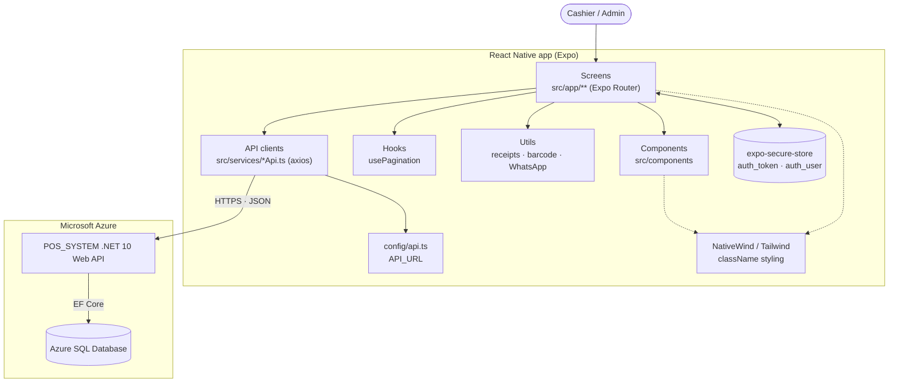

# POS System — Mobile App (Frontend)

A **React Native + Expo** point-of-sale application for retail businesses. It is the mobile client for the **POS_SYSTEM .NET 10 Web API**, which is deployed on **Microsoft Azure** with its data stored in **Azure SQL Database**.


---

## Table of Contents

1. [Project Overview](#1-project-overview)
2. [Application Features](#2-application-features)
3. [Technology Stack](#3-technology-stack)
4. [Project Folder Structure](#4-project-folder-structure)
5. [Application Architecture](#5-application-architecture)
6. [Navigation and Screens](#6-navigation-and-screens)
7. [API Integration with the .NET 10 Backend](#7-api-integration-with-the-net-10-backend)
8. [UI Components and Styling](#8-ui-components-and-styling)
9. [Installation and Setup](#9-installation-and-setup)
10. [Running the Application](#10-running-the-application)
11. [Android Development and Release Builds](#11-android-development-and-release-builds)
12. [Environment Variables and API Configuration](#12-environment-variables-and-api-configuration)
13. [Troubleshooting](#13-troubleshooting)
14. [Known Limitations](#14-known-limitations)
15. [License](#15-license)

---

## 1. Project Overview

This app lets store staff run daily retail operations from a phone or tablet:

- ring up sales at the till (with held and draft sales),
- process returns,
- manage products, customers, suppliers, purchases, stock and expenses,
- administer users, roles and permissions,
- close cashier shifts.

It is a thin client: all business rules and data live in the **.NET 10 Web API** (`POS_SYSTEM`, Clean Architecture, Entity Framework Core). The API runs on **Microsoft Azure** and stores data in **Azure SQL Database**; the app talks to it over HTTPS using JSON.

> **Current backend:** .NET 10 only. The app's API layer was originally written for an earlier FastAPI backend, which has been replaced.

---

## 2. Application Features

Everything below is implemented in the code (screens under `src/app/`, API clients under `src/services/`).

| Area | What you can do |
|------|-----------------|
| **Authentication** | Sign in with username/email + password. The company is detected automatically from the credentials (`/auth/verify-credentials`), with a company dropdown as a fallback. The session is saved in secure device storage; the app redirects to login if no token is stored; log out from the side menu. |
| **POS / New Sale** (`/pos`) | Product search and cart, barcode lookup, retail / wholesale price type, line and manual discounts, tax, customer selection and quick "add customer", loyalty-point redemption, cash / card / split payment, change calculation, choose the cashier, **complete**, **hold (park)** or **save as draft**. |
| **Receipts** | Print a receipt (`expo-print`) and send the receipt text through **WhatsApp** (`src/utils/whatsapp.ts`). |
| **Sales history** (`/pos/sales-history`) | List sales and open a sale detail. |
| **Held sales / Drafts** | List parked sales and drafts and resume them in the POS screen. |
| **Returns & refunds** (`/pos/returns`) | Look up an invoice and create a return (`Sales Return` or `Refund`). |
| **Cashier shift** (`/pos/cashier-shift`) | View a shift summary and close the shift. |
| **Products** | List, add, edit, delete; image upload (image picker); auto-generated EAN-13 barcodes; camera **barcode scanner** (`products/scan`); **barcode label** printing/sharing; single **price update** and **bulk price update**. |
| **Categories, Brands, Units** | List and manage each lookup (`products/categories`, `products/brands`, `products/units`). |
| **Inventory** | Current stock list with filters, stock detail/edit, and PDF export/share of the stock list. |
| **Purchases** | Purchase list and a "new purchase" form (items, sizes, branch). |
| **Suppliers** | List, add, edit, view. |
| **Customers** | List, add, edit, view (with PDF export/share), loyalty-points summary and per-customer history / adjustment. |
| **Expenses** | Expense list with summary and a **donut chart** by category (`ExpenseDonutChart`), add expense. |
| **Users, Roles, Permissions** | Manage users and roles, assign permissions through a hierarchical **permission tree** (`PermissionTree`), create permissions and modules. |
| **Settings** | Company info (with logo upload) and branches. |
| **Permission-based menu** | The side menu only shows entries whose permission key was returned at login. |

---

## 3. Technology Stack

Versions are taken from `package.json`.

| Category | Technology |
|----------|-----------|
| Framework | **Expo** `~57.0.25` (SDK 57), **React Native** `0.86.3`, **React** `19.2.3` |
| Language | **TypeScript** `~6.0.3` (strict mode) |
| Navigation | **Expo Router** `~57.0.23` (file-based routing, `typedRoutes` enabled) |
| Styling | **NativeWind** `^4.2.6` + **Tailwind CSS** `^3.4.19` |
| HTTP client | **axios** `^1.19.0` (plus a few `fetch` calls) |
| Secure storage | `expo-secure-store` |
| Camera / images | `expo-camera`, `expo-image-picker`, `expo-image` |
| Printing / sharing | `expo-print`, `expo-sharing`, `react-native-view-shot` |
| Barcodes & charts | `react-native-barcode-svg`, `react-native-svg` |
| Forms & inputs | `@react-native-community/datetimepicker`, `@react-native-picker/picker`, `react-native-keyboard-aware-scroll-view` |
| Animation / gestures | `react-native-reanimated` `4.5.1`, `react-native-worklets`, `react-native-gesture-handler` |
| Icons | `@expo/vector-icons` (Ionicons) |
| Builds | **EAS Build** (`eas.json`), `expo-dev-client`, `expo-build-properties` |
| Experiments enabled | `typedRoutes`, `reactCompiler` (`app.json`) |
| Backend (external) | **.NET 10 Web API** on **Microsoft Azure**, **Azure SQL Database** |

---

## 4. Project Folder Structure

`node_modules/`, `.expo/`, `dist/` and generated native/build output are omitted.

```text
Frontend/
├── src/
│   ├── app/                          # Expo Router routes (file-based)
│   │   ├── _layout.tsx               # Root Stack + auth-token check
│   │   ├── index.tsx                 # Redirects "/" to "/pos"
│   │   ├── login.tsx                 # Login screen
│   │   └── (tabs)/                   # Route group for all signed-in screens
│   │       ├── pos/                  # New sale, sales-history, held-sales, drafts, returns, cashier-shift
│   │       ├── products/             # list, add, [id], scan, barcode-labels, price-update,
│   │       │                         #   bulk-price-update, categories, brands, units
│   │       ├── inventory/current-stock/
│   │       ├── purchases/            # list, add
│   │       ├── suppliers/            # list, add, [id], view/[id]
│   │       ├── customers/            # list, add, [id], view/[id], loyalty/ , loyalty/[id]
│   │       ├── expenses/             # list, add
│   │       ├── users/                # list, add, [id], view/[id], roles/, permissions/
│   │       └── settings/             # company-info/, branches/
│   ├── components/                   # Reusable UI (SideMenu, Dropdown, PaginationBar, PermissionTree,
│   │                                 #   ExpenseDonutChart, and *Card / *Row list items)
│   ├── services/                     # One axios-based API client per backend resource (19 files)
│   ├── hooks/
│   │   └── usePagination.ts          # Client-side pagination hook
│   ├── utils/                        # barcode.ts, printReceipt.ts, saleReceipt.ts, whatsapp.ts
│   └── config/
│       └── api.ts                    # API base URL (API_URL)
├── app.json                          # Expo app config (name, Android package, plugins)
├── eas.json                          # EAS Build profiles
├── package.json                      # Dependencies and scripts
├── tsconfig.json                     # TypeScript config (strict, "@/*" alias → ./src/*)
├── babel.config.js                   # babel-preset-expo + NativeWind
├── metro.config.js                   # Metro + NativeWind (global.css)
├── tailwind.config.js                # Tailwind content paths + NativeWind preset
├── global.css                        # Tailwind directives
├── expo-env.d.ts · nativewind-env.d.ts
└── LICENSE
```

> `app.json` references image files under `./assets/` (icon, splash, adaptive icon). That folder is not part of this source snapshot; make sure it exists in your repository.

---

## 5. Application Architecture

The app is organised in simple layers: **screens** (Expo Router files) use **components** and **services**; services call the **.NET 10 API** hosted on Azure; the session lives in **SecureStore**.



**Typical flow (making a sale):** `pos/index.tsx` → `saleApi.createSale()` → `POST /sales/` on the .NET API → API writes to Azure SQL → response (`InvoiceNo`, change) → receipt shown/printed.

**State management:** there is no global store or React Context. Each screen keeps its own state with React hooks (`useState`, `useEffect`); the logged-in user's session is read from SecureStore (`getStoredUser`, `getStoredPermissions`).

---

## 6. Navigation and Screens

Navigation uses **Expo Router** (file-based). The root layout (`src/app/_layout.tsx`) renders a header-less `Stack`. Inside `(tabs)/` there is **no `_layout.tsx`**, so it is only a route group (no bottom tab bar); movement between sections happens through a custom slide-in **side menu** (`src/components/SideMenu.tsx`).

**Start-up flow**

1. `_layout.tsx` reads the stored token (`getStoredToken`). If none exists → `router.replace("/login")`.
2. `index.tsx` redirects `/` to `/pos`.
3. After a successful login → `/(tabs)/products`.
4. Logout (side menu) clears SecureStore and returns to `/login`.

### Routes

| Route | File | Purpose |
|-------|------|---------|
| `/login` | `login.tsx` | Sign in |
| `/pos` | `(tabs)/pos/index.tsx` | New sale (cart, payment, hold/draft) |
| `/pos/sales-history` · `/pos/sales-history/[id]` | `pos/sales-history/` | Sales list and detail |
| `/pos/held-sales` | `pos/held-sales/index.tsx` | Parked sales |
| `/pos/drafts` | `pos/drafts/index.tsx` | Draft invoices |
| `/pos/returns` | `pos/returns/index.tsx` | Returns & refunds |
| `/pos/cashier-shift` | `pos/cashier-shift/index.tsx` | Shift summary and close |
| `/products` · `/products/add` · `/products/[id]` | `products/` | Product list / create / edit |
| `/products/scan` | `products/scan.tsx` | Camera barcode scanner |
| `/products/barcode-labels` | `products/barcode-labels.tsx` | Print/share barcode labels |
| `/products/price-update` · `/products/bulk-price-update` | `products/` | Price changes |
| `/products/categories` · `/products/brands` · `/products/units` | `products/*/index.tsx` | Lookup management |
| `/inventory/current-stock` · `/inventory/current-stock/[id]` | `inventory/current-stock/` | Stock list and detail |
| `/purchases` · `/purchases/add` | `purchases/` | Purchases |
| `/suppliers` · `/suppliers/add` · `/suppliers/[id]` · `/suppliers/view/[id]` | `suppliers/` | Suppliers |
| `/customers` · `/customers/add` · `/customers/[id]` · `/customers/view/[id]` | `customers/` | Customers |
| `/customers/loyalty` · `/customers/loyalty/[id]` | `customers/loyalty/` | Loyalty points |
| `/expenses` · `/expenses/add` | `expenses/` | Expenses |
| `/users` · `/users/add` · `/users/[id]` · `/users/view/[id]` | `users/` | Users |
| `/users/roles` · `/users/roles/add` · `/users/roles/[id]` | `users/roles/` | Roles |
| `/users/permissions` · `/users/permissions/add` | `users/permissions/` | Permissions |
| `/settings/company-info` · `/settings/company-info/add` | `settings/company-info/` | Company information |
| `/settings/branches` · `/settings/branches/add` · `/settings/branches/[id]` | `settings/branches/` | Branches |

(Route groups such as `(tabs)` do not appear in URLs.)

### Permission-based side menu

At login the API returns `PermissionKeys` (for example `products.list`, `pos.new_sale`). `SideMenu` filters each section by those keys, so users only see the entries they are allowed to. Sections: POS, Products, Inventory, Purchases, Suppliers, Customers, Expenses, Users & Roles, Settings.

> **Menu entries without a screen yet.** `SideMenu.tsx` lists some items whose target route has no file in `src/app/`: Inventory → *Stock In, Stock Out, Stock Adjustment, Low Stock Alert, Stock Count*; Purchases → *Purchase Returns, Supplier Dues*; Suppliers → *Supplier Ledger*; Customers → *Customer Ledger*; Expenses → *Expense Categories*; Users & Roles → *Activity Log*; Settings → *Tax & VAT, Invoice Template, Backup & Restore*; plus the *Dashboard* entry (no navigation). These are placeholders, not implemented features.

---

## 7. API Integration with the .NET 10 Backend

### How the app reaches the deployed API

```text
Mobile app  ──HTTPS──▶  POS_SYSTEM .NET 10 Web API (Microsoft Azure)  ──TLS──▶  Azure SQL Database
 (axios)                  controllers → services → repositories (EF Core)
```

- The app **never connects to the database**. It only calls the REST API; the API is the one that connects to Azure SQL Database (with credentials kept in the API's own Azure configuration, never in this app).
- Every service file creates an axios instance with `baseURL: API_URL` imported from `src/config/api.ts`, e.g. `export const saleApi = axios.create({ baseURL: API_URL, ... })`.
- Point `API_URL` at the public HTTPS address of your Azure-hosted API (`https://<your-api-host>`), see [§12](#12-environment-variables-and-api-configuration).

### JSON conventions

The .NET API serialises property names in PascalCase and rewrites `Id` to `ID` (e.g. `CategoryID`, `ProductID`), except `CustomerId` and `SupplierId`. The TypeScript types in `src/services/*` mirror this (for example `LoginResponse` has `UserID`, `PrimaryBranchID`, `PermissionKeys`). Errors come back as `{ "detail": "..." }`, which screens display in alerts (`err.response.data.detail`).

### Authentication

1. `POST /auth/verify-credentials` is called (debounced, 600 ms) while the user types, to auto-detect the company.
2. `POST /auth/login` with `{ CompanyID, UsernameOrEmail, Password }` returns the JWT (`access_token`) and profile.
3. `saveSession()` stores `auth_token` and `auth_user` (the whole login response, including `PermissionKeys`) in **expo-secure-store**.

> The stored token is currently **not attached** to API requests: there is no axios interceptor and no `Authorization` header in `src/services/`. This works only while the API does not require authentication. If the backend starts enforcing `[Authorize]`, add the header (see [Known Limitations](#14-known-limitations)).

### API clients (`src/services/`)

| File | Backend routes used |
|------|---------------------|
| `authApi.ts` | `POST /auth/login`, `POST /auth/verify-credentials`; SecureStore session helpers |
| `companyApi.ts` | `GET/POST /companies/`, `GET/PUT/DELETE /companies/{id}`, `POST /companies/upload-logo` |
| `branchApi.ts` | `/branches/` (CRUD) |
| `productApi.ts` | `/products/` (CRUD), `/products/categories`, `/brands`, `/units`, `/next-code`, `/by-barcode/{barcode}`, `POST /bulk-price-update`, `PUT /{id}/price`, `POST /upload-image` |
| `categoryApi.ts` · `brandApi.ts` · `unitApi.ts` | `/categories/`, `/brands/`, `/units/` (CRUD) |
| `customerApi.ts` | `/customers/` (CRUD), `/customers/next-code` |
| `supplierApi.ts` | `/suppliers/` (CRUD), `/suppliers/next-code` |
| `saleApi.ts` | `/sales/` (list, create), `/sales/{id}` (detail, delete), `/sales/next-invoice-no`, `/sales/cashiers`, `/sales/cashiers-list`, `/sales/held`, `/sales/held/{id}`, `/sales/drafts`, `/sales/drafts/{id}` |
| `saleReturnApi.ts` | `GET /sale-returns/lookup/{invoiceNo}`, `POST /sale-returns/` |
| `purchaseApi.ts` | `/purchases/` (list, create, delete), `/purchases/branches`, `/purchases/sizes`, `/purchases/next-number` |
| `stockApi.ts` | `GET /stock/`, `GET/PUT /stock/{id}` |
| `loyaltyApi.ts` | `GET /loyalty/summary`, `GET /loyalty/history/{customerId}`, `POST /loyalty/adjust` |
| `expenseApi.ts` | `/expenses/` (list, create, delete), `/expenses/categories`, `/expenses/summary`, `/expenses/by-category`, `/expenses/next-number` |
| `cashierShiftApi.ts` | `GET /cashier-shifts/summary`, `POST /cashier-shifts/` |
| `userApi.ts` | `/users/` (CRUD), `/users/roles`, `/users/permissions/tree`, `/users/roles/{id}/permissions` |
| `roleApi.ts` | `/roles/` (CRUD) |
| `permissionApi.ts` | `/permissions/`, `/permissions/modules` (create/list), `DELETE /permissions/{id}` |

### Example

```ts
// src/services/saleApi.ts
export const createSale = async (data: SaleCreateInput) => {
  const res = await saleApi.post("/sales/", data);
  return res.data;   // { SaleID, InvoiceNo, GrandTotal, ChangeAmount, Status }
};
```

---

## 8. UI Components and Styling

### Styling approach

- **NativeWind v4** brings Tailwind classes to React Native: components use the `className` prop (e.g. `className="flex-1 items-center justify-center bg-gray-50"`).
- Setup files: `tailwind.config.js` (content paths `src/**`, NativeWind preset), `global.css` (Tailwind directives, imported once in `src/app/_layout.tsx`), `babel.config.js` (`jsxImportSource: "nativewind"` and `nativewind/babel`), `metro.config.js` (`withNativeWind(config, { input: './global.css' })`) and `nativewind-env.d.ts` (types).
- There is no custom theme (`theme.extend` is empty); the UI uses default Tailwind colours (blue primary, gray surfaces, dark navy `#0F1B2D` side menu). `userInterfaceStyle` is `automatic` in `app.json`, but screens use fixed light-style classes.
- Icons come from Ionicons (`@expo/vector-icons`).

### Reusable components (`src/components/`)

| Component | Purpose |
|-----------|---------|
| `SideMenu` | Animated slide-in navigation drawer, permission-filtered, with logout |
| `Dropdown` | Generic `{ id, name }` select |
| `PaginationBar` | Page controls (works with `usePagination`) |
| `PermissionTree` · `PermissionRow` | Hierarchical permission selection / listing |
| `ExpenseDonutChart` | SVG donut chart (`react-native-svg`) for expenses by category |
| `ProductCard`, `CategoryCard`, `BrandCard`, `UnitCard`, `CustomerCard`, `SupplierCard`, `PurchaseCard`, `StockCard` | List cards |
| `UserRow`, `RoleRow`, `CompanyRow`, `BranchRow`, `ExpenseRow`, `SaleRow` | List rows |

### Hook and utilities

| File | Purpose |
|------|---------|
| `hooks/usePagination.ts` | Client-side pagination (`currentPage`, `pageSize`, `paginatedData`, `nextPage`, `prevPage`, …) |
| `utils/barcode.ts` | `generateEAN13()` — in-store EAN-13 with check digit |
| `utils/printReceipt.ts` | Builds receipt HTML and prints via `expo-print` |
| `utils/saleReceipt.ts` | Converts `SaleDetail` to receipt data |
| `utils/whatsapp.ts` | Normalises phone numbers (default country code `880`) and opens WhatsApp with the receipt text |

---

## 9. Installation and Setup

### Prerequisites

| Tool | Notes |
|------|-------|
| [Node.js](https://nodejs.org) (LTS) and npm | Use the Node version required by Expo SDK 57 (see the [Expo SDK 57 docs](https://docs.expo.dev/versions/v57.0.0/)). |
| Git | To clone the repository. |
| A running POS API | Your deployed Azure API, or the .NET 10 API running locally. |
| Android Studio (Android SDK + emulator) and JDK | For Android builds and the emulator. |
| An Android phone (optional) | USB debugging enabled, or install a built APK. |
| EAS CLI (for cloud builds) | `npm install -g eas-cli` and a free Expo account. |

> This project uses native modules and `expo-dev-client`, so run it in a **development build** (`expo run:android` or an EAS development build) rather than Expo Go.

### Steps

```bash
# 1. Clone
git clone <your-repository-url>
cd <repository>/Frontend        # the folder containing package.json

# 2. Install dependencies
npm install

# 3. Point the app at your API (see section 12)
#    edit src/config/api.ts
```

---

## 10. Running the Application

`package.json` scripts:

| Command | What it does |
|---------|--------------|
| `npm start` | Starts the Expo dev server (`expo start`) |
| `npm run android` | Builds and runs the native Android app (`expo run:android`) |
| `npm run ios` | Builds and runs on iOS (`expo run:ios`, macOS only) |
| `npm run web` | Starts the web target (`expo start --web`) |
| `npm run lint` | `expo lint` |

Typical development session:

```bash
# first run: build and install the development client on an emulator / connected phone
npm run android

# afterwards, start the dev server and open the installed app
npm start
```

Login requires a user that exists in the backend database. A new empty database has no users; create the company, branch, role and user through the API first (see the backend README).

### Using a local backend

Run the .NET API on your computer, listening on the network so a phone/emulator can reach it:

```bash
# in the backend repository
ASPNETCORE_ENVIRONMENT=Development dotnet run --project POS_SYSTEM.Api --urls "http://0.0.0.0:5000"
```

Then set `API_URL` to `http://<your-computer-LAN-IP>:5000` (from the Android emulator use `http://10.0.2.2:5000`). Plain `http://` works because `app.json` enables cleartext traffic on Android (`usesCleartextTraffic: true`) — **use HTTPS for anything beyond local development**.

---

## 11. Android Development and Release Builds

App identity (`app.json`): name `frontend`, slug `frontend`, version `1.0.0`, Android package **`com.faysaal70.frontend`**, portrait orientation.

The repository does not contain a generated `android/` folder. Expo creates it when you run `expo run:android` or `expo prebuild`.

### 11.1 Local development build

```bash
npm run android
```

Requires Android Studio with the SDK installed, `ANDROID_HOME` set, and an emulator or a USB-connected device.

### 11.2 EAS Build profiles (`eas.json`)

| Profile | Purpose | Output |
|---------|---------|--------|
| `development` | Development client, internal distribution | Dev client build |
| `preview` | Internal testing | **APK** (`buildType: "apk"`), sets `EXPO_PUBLIC_API_URL` for the build |
| `production` | Store release, `autoIncrement: true` (remote version source) | Android App Bundle (default for production) |

```bash
npm install -g eas-cli
eas login

# installable APK for testers
eas build --platform android --profile preview

# development client
eas build --platform android --profile development

# production bundle for Google Play
eas build --platform android --profile production
```

EAS manages the Android signing keystore for you the first time you build (`eas credentials` to inspect it). Keep your keystore and credentials private.

### 11.3 Publishing to Google Play

```bash
eas submit --platform android --profile production
```

The `submit.production` profile in `eas.json` is empty; you need to provide a Google Play service-account key through EAS when prompted. `<do not commit this file>`

### 11.4 Local release build (optional)

```bash
npx expo prebuild --platform android
cd android && ./gradlew assembleRelease     # APK
# or: ./gradlew bundleRelease               # AAB
```

A local release build must be signed with **your own** release keystore (configure it in `android/app/build.gradle`); never ship with the default debug key.

### 11.5 Release checklist

- [ ] `API_URL` points to the production HTTPS API on Azure.
- [ ] `usesCleartextTraffic` is turned off in `app.json` if the app no longer needs plain HTTP.
- [ ] `version` is updated in `app.json` (EAS auto-increments the build number in the `production` profile).
- [ ] App name/slug (`frontend`) and icons in `assets/` are final.
- [ ] Test the APK on a real device, including login, a sale and receipt printing.

---

## 12. Environment Variables and API Configuration

### Where the API address is set today

The base URL is a constant in **`src/config/api.ts`**:

```ts
export const API_URL = "https://<your-api-host>";   // e.g. your Azure-hosted .NET 10 API
```

Edit this value for each environment (local / staging / production). The file currently contains alternative URLs as comments and a hard-coded development tunnel address; replace them with your own.

### `EXPO_PUBLIC_API_URL`

`eas.json` defines `EXPO_PUBLIC_API_URL` in the `preview` profile, but **no source file reads it yet**, so it has no effect at the moment. To drive the URL from an environment variable (recommended), change `src/config/api.ts` to:

```ts
export const API_URL =
  process.env.EXPO_PUBLIC_API_URL ?? "https://<your-api-host>";
```

Then set it per build:

| Where | How |
|-------|-----|
| Local development | `EXPO_PUBLIC_API_URL=http://<LAN-IP>:5000 npm start` (or a local `.env` file that is **git-ignored**) |
| EAS builds | `env` block of the profile in `eas.json`, or `eas env:create` for sensitive values |

`EXPO_PUBLIC_*` values are embedded in the app bundle and visible to anyone who has the app — **never put passwords, API keys, tokens or connection strings in them**.

### What belongs where

| Item | Location |
|------|----------|
| Azure SQL connection string, JWT signing key | **Backend only** (Azure application settings of the .NET API) — never in this app |
| API base URL | `src/config/api.ts` / `EXPO_PUBLIC_API_URL` |
| User session token | Device SecureStore (`auth_token`) at runtime |

### Backend requirements

- Reachable over **HTTPS** from the phone, with a certificate chain Android trusts (include the intermediate certificate on the server).
- If the API's Azure host restricts access (firewall/IP rules), allow your clients.
- CORS is only relevant if you use the `web` target; the .NET API has no CORS policy configured at present.

---

## 13. Troubleshooting

| Symptom | Likely cause / fix |
|---------|--------------------|
| "API Error … Network Error" alert on the login screen | Wrong `API_URL`, API offline, or device cannot reach it. Test the URL in the phone's browser. |
| Works in browser but not on Android: *Trust anchor for certification path not found* | The server's certificate chain is incomplete or its root is not trusted on that Android version (seen on older Android). Serve the full chain including the intermediate certificate. The repository's `android.txt` contains notes about this case. |
| `http://` URL is blocked | Cleartext is allowed by `app.json` for Android, but not on iOS; use HTTPS. |
| Changes to `className` have no effect | Restart with a clean cache: `npx expo start -c`. |
| Login says "User does not belong to the selected company" | The user's primary branch belongs to another company; use the company detected from the credentials. |
| Filters on some lists appear ignored | See [Known Limitations](#14-known-limitations) (query-parameter names). |

---

## 14. Known Limitations

Recorded so contributors know the current state of the code:

1. **No auth header.** The JWT is stored but never sent. Add an axios request interceptor (or a shared axios instance) that reads `getStoredToken()` and sets `Authorization: Bearer <token>` before enabling `[Authorize]` on the API. Currently every service file builds its own axios instance.
2. **Query-parameter names differ from the .NET API.** Several services still send snake_case names from the old backend, while the .NET controllers expect camelCase, so these values are silently ignored:

   | Frontend sends | .NET API expects | Endpoint |
   |----------------|------------------|----------|
   | `date_from`, `date_to`, `customer_id`, `cashier_id`, `payment_status` | `dateFrom`, `dateTo`, `customerId`, `cashierId`, `paymentStatus` | `GET /sales` |
   | `date_from`, `date_to`, `supplier_id` | `dateFrom`, `dateTo`, `supplierId` | `GET /purchases` |
   | `category_id`, `brand_id`, `branch_id` | `categoryId`, `brandId`, `branchId` | `GET /stock` |
   | `purchase_date` | `purchaseDate` | `GET /purchases/next-number` |
   | `expense_date` | `expenseDate` | `GET /expenses/next-number` |

   (`/expenses` list/summary filters use `date_from`, `date_to`, `category_id`, `payment_method`, which do match the API; `/cashier-shifts/summary` also matches.)
3. **Extra fields in the sale request.** `POST /sales/` also sends `Payments`, `DiscountType`, `DiscountValue` and `LoyaltyPointsToRedeem`; the .NET `SaleCreateDto` does not define them, so they are ignored (payment breakdown is not persisted by the API).
4. **Hard-coded API URL** in `src/config/api.ts` (see §12).
5. **Placeholder menu items** without screens (see §6).
6. **Incomplete project files:** no `.gitignore`, no `assets/` folder in this snapshot, and the `reset-project` script points to a file that does not exist.
7. **No automated tests** and no global error/loading layer; each screen handles errors with `Alert`.

---

## 15. License

See the [LICENSE](./LICENSE) file.
